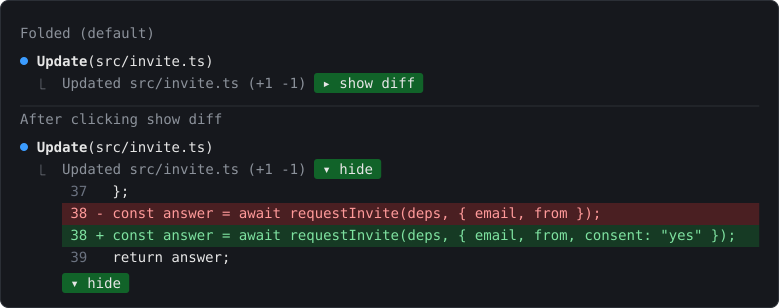

# T-mods

**My mods for Claude Code.** A mod is a Claude Code plugin made of function hooks: a TypeScript module that can redraw parts of the terminal, add slash commands, or act on tool calls.

[View on GitHub](https://github.com/Tatendaz/T-mods) [Install](#install)



## Who it is for

Claude Code users who want working examples of function-hook plugins, and anyone who runs Claude Code the way I do: many agents at once in herdr tabs, PRs reviewed by CodeRabbit, and pushes to a phone.

These are my own mods, built for that setup. fold-edits, compact-keeper and phone-check-nudge need nothing outside Claude Code. The other three call tools that are not in this repo.

## The six mods

| Mod | What it does | Needs |
| --- | --- | --- |
| [fold-edits](https://github.com/Tatendaz/T-mods/tree/main/fold-edits) | Folds every Edit and Write diff, and the diff under a shell command that changed files, into one line, with a green button that opens the diff. | nothing else |
| [merge-gate](https://github.com/Tatendaz/T-mods/tree/main/merge-gate) | Refuses `gh pr merge` until the head has green CI, a real review, 0 open threads and, on listed repos, an Astra line. Shows the CodeRabbit budget in the status line. | `gh`, `coderabbit_status.py` and `coderabbit_budget.py` in `~/.claude/skills/tatendaz-github/scripts/` |
| [swarm-board](https://github.com/Tatendaz/T-mods/tree/main/swarm-board) | `/board` opens a live pane of the repo's open PRs, merges in the last 24 hours, herdr agents and what needs you. No model call. | `git`, `gh`, herdr |
| [swarm-janitor](https://github.com/Tatendaz/T-mods/tree/main/swarm-janitor) | Every 3 minutes, closes the herdr tab of an idle agent whose worktree PR merged, and pushes your phone when an agent stays blocked. | herdr, `git`, `gh`, `~/.claude/bin/phone-notify` |
| [compact-keeper](https://github.com/Tatendaz/T-mods/tree/main/compact-keeper) | Makes every compaction quote your decisions, approvals and open questions word for word. | nothing else |
| [phone-check-nudge](https://github.com/Tatendaz/T-mods/tree/main/phone-check-nudge) | After a turn that edited UI files and never looked at them, shows a band with a Run check button. | nothing else |

## Install

Clone the repo to `~/.claude/mods`:

```sh
git clone https://github.com/Tatendaz/T-mods.git ~/.claude/mods
```

Then list each mod folder in the `env` block of `~/.claude/settings.json`. Separate folders with `:`.

```json
"env": {
  "CLAUDE_CODE_PLUGIN_DIRS": "~/.claude/mods/fold-edits"
}
```

New sessions load every listed mod. Saving a file in a listed folder reloads that mod in a running session.

To try one mod for a single session:

```sh
claude --plugin-dir ~/.claude/mods/fold-edits
```

## Status

Every mod is at version 0.1.0.

- The plugin API is early access, and it can change between Claude Code releases. These mods were last checked on Claude Code 2.1.288.
- merge-gate is a guardrail against Claude merging by mistake, not a wall. A script file that runs `gh pr merge` is not caught. Its live merge path has not been run; the tests use a fake `gh`.
- compact-keeper has tests but has not been watched on a real `/compact` yet.
- The repo has no license file.

## Built by Tatenda Zhou

[More work](https://tatendaz.github.io/) · [Follow on X](https://x.com/realtatendazhou) · [LinkedIn](https://www.linkedin.com/in/tatendazhou)

Need help making AI coding agents reliable? [tatendaz@me.com](mailto:tatendaz@me.com?subject=Making%20AI%20coding%20agents%20reliable)
